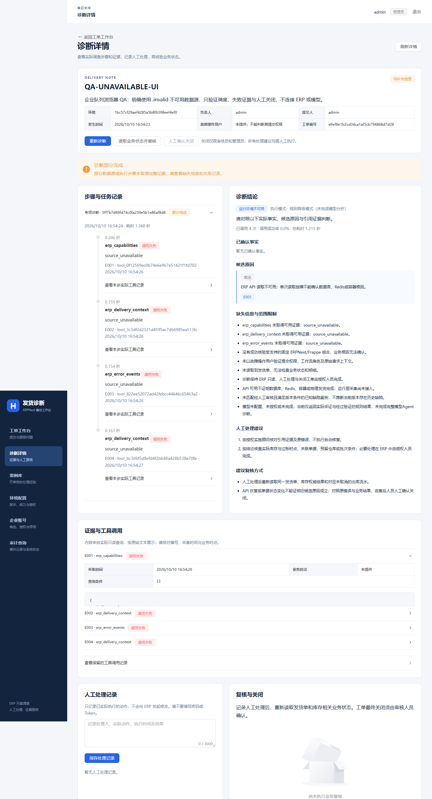
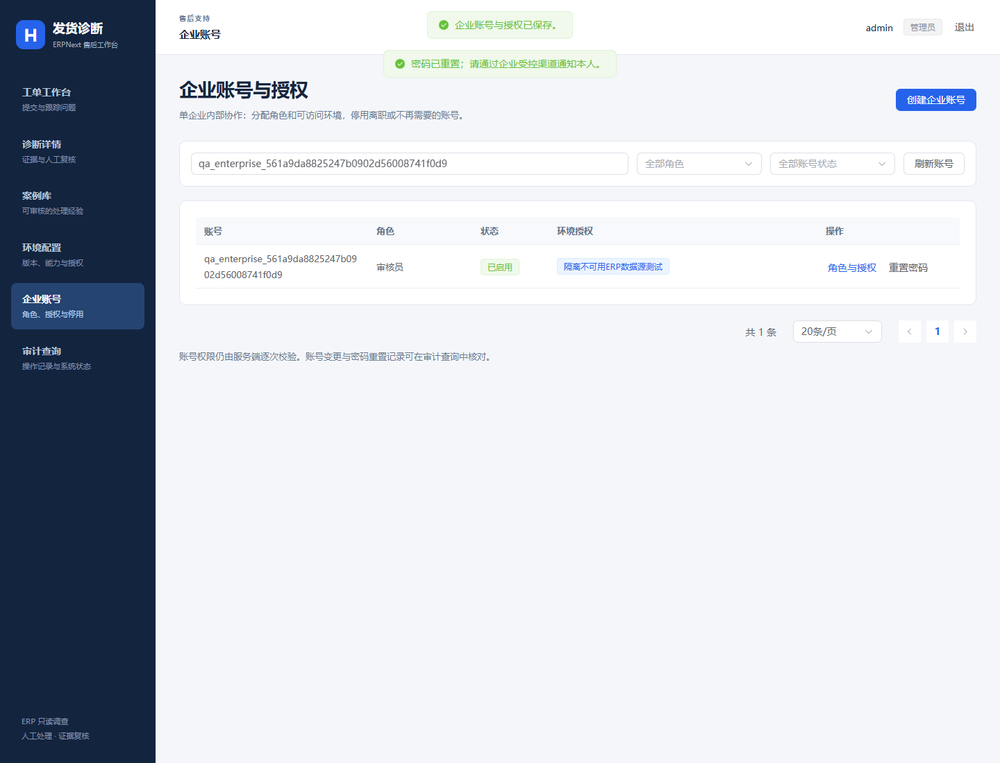
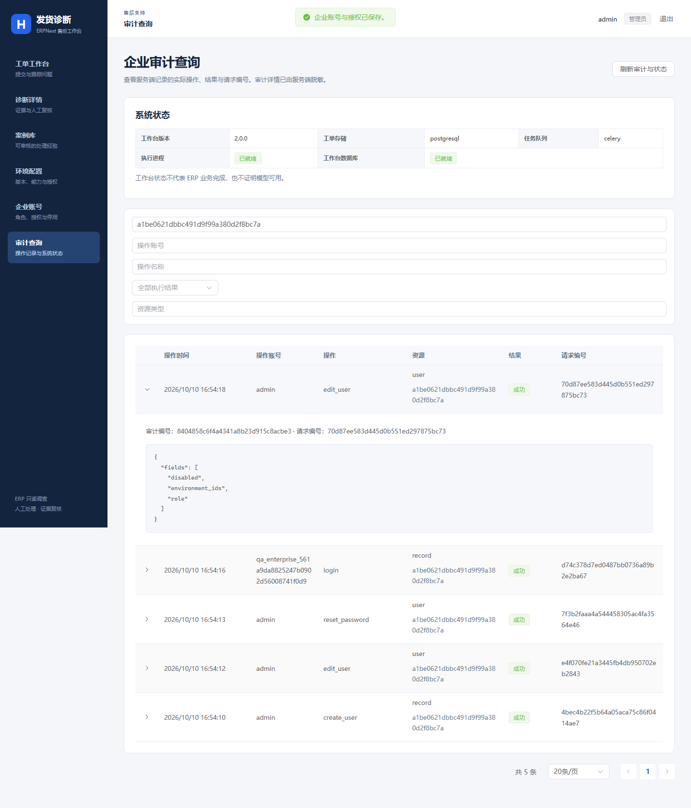
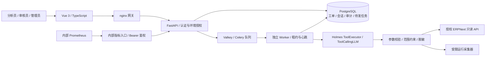

<div align="center">

# ERPNext 只读诊断工作台

**基于 HolmesGPT 的企业内部售后诊断 Agent · 从异常工单到可追溯证据**

[](LICENSE)


[快速开始](#快速开始) · [功能与界面](#功能与界面) · [系统架构](#系统架构) · [实际验证](#实际验证) · [中文文档](#中文文档)

</div>

面向 **单企业、多账号协作** 的 ERPNext 库存与发货异常诊断工作台。售后人员提交工单，诊断任务在独立 Worker 中读取被授权的业务与运行证据，输出已确认事实、候选原因、证据引用、缺失信息和人工处理建议；处理后由授权人员复核业务状态，并确认关闭工单。

项目复用 [HolmesGPT](https://github.com/HolmesGPT/holmesgpt) 的工具体系和 Agent 执行链路，新增中文 Web 工作台、ERPNext 只读适配、企业持久化、异步任务与隔离部署。**诊断工具不写入 ERP，不执行自动修复。** 工作台可以保存自己的账号、工单、案例和审计记录。

> 当前为 v2 企业工程验证版本，适合隔离演示与授权试点。默认不连接 ERP、不启用模型；未配置模型时明确返回 `rules_degraded`。真实模型效果、生产规模承载与高可用尚未验收。

## 功能与界面

| 能力 | 当前实现 |
| --- | --- |
| 异常工单 | 环境绑定、发货单上下文、异步诊断、人工处理记录、业务复核与人工关闭 |
| 证据驱动诊断 | 事实与候选分开展示，证据编号关联工具调用，记录参数、结果、失败原因与耗时；采证不全时返回 `partial` |
| ERPNext 只读工具 | 版本与能力核验、发货上下文、库存证据、错误事件；受限运行采集器提供容器与日志证据 |
| 多账号协作 | 管理员、分析员、审核员角色，按环境授权；停用、密码重置与权限调整撤销已有会话 |
| 案例与审计 | 人工审核案例，操作与请求编号留痕；审计资源检索、脱敏展示、服务端分页 |
| 可靠任务执行 | PostgreSQL 持久待发记录、独立 Celery Worker、租约与心跳、重复消息保护；中断保留已有证据 |
| 运维与部署 | Docker Compose、存活/就绪检查、内部 Prometheus 指标、受控更新、备份与新目标恢复 |

### 诊断详情：证据不足也有明确结果



截图来自 2026-10-10 的真实浏览器验证。该工单使用故意不可用的 `.invalid` 数据源，4 次调用均失败；页面保留失败证据、缺失信息与人工建议，未确认数据库或缓存根因。它展示的是异常处理能力，不代表真实 ERP 诊断成功。

<details>
<summary>查看账号管理与审计页面</summary>





截图为测试过程中的状态；测试账号随后已停用，授权已清空。详细结果见 [浏览器验证记录](examples/erpnext-support/frontend/reports/enterprise-ui-final-20261010.json)。

</details>

## 快速开始

以下步骤适用于 **Windows PowerShell + Docker Desktop Linux containers**。需要 Git、Python 3.12、Docker Compose，以及可用的 `desktop-linux` Docker context。应用依赖和前端在镜像内构建，无需在宿主安装 Node.js。

部署脚本拒绝自定义 `DOCKER_HOST`。若当前终端设置了该变量，请先检查它的用途，并在使用默认 Docker Desktop context 的终端运行。

已有项目目录、`.venv` 或 8875 端口监听时，先检查现有部署；以下命令用于全新目录，不能覆盖既有环境。首次构建需要下载依赖和镜像，耗时取决于网络与机器资源。

### 1. 获取源码，准备独立 Python 环境

```powershell
$ErrorActionPreference = 'Stop'
$taskRepo = Join-Path (Get-Location) 'erpnext-readonly-workbench'
if (Test-Path -LiteralPath $taskRepo) { throw '目录已存在，请先检查文件与 Git 状态。' }
git clone --depth 1 https://github.com/fjjh1413/erpnext-readonly-workbench.git $taskRepo
if ($LASTEXITCODE -ne 0) { throw '克隆失败。' }
Set-Location $taskRepo

py -3.12 -m venv .venv
if ($LASTEXITCODE -ne 0) { throw '需要可用的 Python 3.12。' }
# 宿主部署脚本仅需这两个包；完整运行依赖由 Docker 按锁文件安装。
.\.venv\Scripts\python.exe -m pip install 'requests==2.34.2' 'tenacity==9.1.4'
if ($LASTEXITCODE -ne 0) { throw '部署脚本依赖安装失败。' }
docker --context desktop-linux version
if ($LASTEXITCODE -ne 0) { throw '请启动 Docker Desktop，并切换到 Linux containers。' }
```

### 2. 构建并启动工作台

```powershell
$taskEnterprise = '.\examples\erpnext-support\enterprise\run.ps1'
$taskBuild = (& $taskEnterprise -Action BuildContext).Trim()
$taskImage = 'holmes-erp-enterprise:' + (Get-Date -Format 'yyyyMMddHHmmss')
docker --context desktop-linux build --tag $taskImage $taskBuild
if ($LASTEXITCODE -ne 0) { throw '镜像构建失败，不能继续启动。' }

$taskConfig = ((& $taskEnterprise -Action Prepare -Image $taskImage) | ConvertFrom-Json).config
# 如需接入测试 ERP，此时配置服务端 settings / credentials，详见下一节。
& $taskEnterprise -Action Start -Config $taskConfig -Monitoring
& $taskEnterprise -Action Check -Config $taskConfig
Invoke-RestMethod http://127.0.0.1:8875/ready
```

浏览器打开 **[http://127.0.0.1:8875](http://127.0.0.1:8875)**。

随机初始管理员账号保存在 `$taskConfig` 所在目录下的 **`state/initial-login.json`**。在本机私下查看该文件，登录后修改密码；不要提交或分享登录文件。每次 `Prepare` 都创建独立随机项目，脚本拒绝接管已有同名资源。请保存返回的配置路径，后续管理使用同一路径。

`/health` 表示 API 存活；`/ready` 同时检查数据库、队列和近期 Worker 心跳。首次启动需等待依赖导入及数据库迁移完成。

### 3. 接入被授权的测试 ERP

纯工作台演示可以不接 ERP。需要诊断业务时，应在 **Prepare 之后、首次 Start 之前** 完成服务端配置；已启动的项目先按部署文档停止并重新启动：

1. 在新项目 `state/settings.json` 的 `allowed_erp_origins` 中明确授权 ERP 的 **HTTPS origin**。
2. 将专用只读账号的凭据放在 `state/credentials/`，前端只填写凭据别名。
3. 管理员登记环境并分配访问权限，再由分析员创建工单。
4. 模型为可选能力，需服务端配置与环境级授权；本仓库不附带模型或 ERP 密钥。

当前 ERP 适配验证版本为 **ERPNext 15.85.1 / Frappe 15.87.0**；运行层采集器当前适配所属隔离实验，客户接入需单独审核。容器内 `127.0.0.1` 指向容器自身，不能直接照搬宿主 ERP 地址；普通远程 HTTP 源会被策略拒绝。完整步骤见 [部署说明](examples/erpnext-support/enterprise/README.md)、[接入与模型说明](examples/erpnext-support/README.md) 和 [ERP 实验室](examples/erpnext-support/lab/README.md)。

### 4. 检查、暂停与备份

```powershell
& $taskEnterprise -Action Check -Config $taskConfig
$taskBackup = ((& $taskEnterprise -Action Backup -Config $taskConfig) | ConvertFrom-Json).backup
& $taskEnterprise -Action Stop -Config $taskConfig
```

`Stop` 保留数据库与卷。备份含工单、证据和账号等敏感工作台数据，应留在受控私有目录。恢复仅允许新的空数据库；更新镜像、恢复与删除数据的操作见 [企业部署说明](examples/erpnext-support/enterprise/README.md)。v2 不自动导入旧 SQLite，迁移须显式只读复制到空目标，见 [持久层与迁移](holmes/erpnext_support/persistence/README.md)。

## 系统架构



API 接受任务并持久化，独立 Worker 采证并写回结果。队列短时不可用时任务保留在数据库；恢复后发布原任务。执行进程中断时，租约机制将任务标记为 `interrupted`，保留已完成工具记录，不自动重跑整段调查。

| 层 | 技术栈与用途 |
| --- | --- |
| 前端 | Vue 3.5.43、Element Plus 2.14.7、TypeScript 5.9.3、Vite 8.3.2；严格类型检查与组件测试 |
| 后端与 Agent | Python 3.12.10、FastAPI 0.136.3；复用 Holmes 工具与模型执行链路 |
| 持久化 | PostgreSQL 17.11、SQLAlchemy 2、Alembic 1.18.4；事务、共享会话、审计与迁移 |
| 异步任务 | Celery 5.6.3、Valkey 8.1.10；独立进程、持久待发记录与重复执行保护 |
| 部署与观测 | Docker Compose、nginx 1.30.5、Prometheus 3.13.4 LTS |

主运行依赖由 `poetry.lock` 固定，企业新增依赖单独固定，前端使用 `package-lock.json`。镜像基线、digest 与本机测试环境差异见 [版本清单](examples/erpnext-support/enterprise/VERSIONS.md)。这是已验证的版本组合，不表示自动跟随最新版。

### 访问与数据边界

- ERP origin 白名单、环境授权、参数校验、调用次数与时间预算共同约束采证范围；输出脱敏并保留失败记录。
- 企业应用容器不挂载 Docker socket。数据库、队列与监控不发布宿主端口，公开指标入口关闭；本地网页只绑定 `127.0.0.1:8875`。
- 应用与迁移数据库角色分开，应用无 DDL 权限，既有审计事件不可通过应用角色修改或删除。
- 默认单 Worker、并发 1。当前未实现 OIDC、MFA、多企业租户、跨机高可用或生产规模压测；外部访问的 TLS 与运维流程需另行验收。

## 实际验证

以下为已保存的本机结果。检查点、工具调用和业务诊断属于不同指标；部分回归用例有重叠，不能将各行相加为独立场景数。原失败轮次与修正说明保留在报告中。

| 验证层 | 实际结果 | 耗时 | 原始证据 |
| --- | --- | --- | --- |
| 后端核心 / API / 任务契约（2026-10-10） | 68 项通过，外部 ERP/模型为 mock | 119.68 秒 | [JUnit](examples/erpnext-support/reports/enterprise-core-api-jobs-final-20261010.xml) |
| 前端组件（2026-10-10） | 49 项 mock 测试通过，类型与构建检查通过 | 测试 86.84 秒 | [记录](examples/erpnext-support/frontend/reports/enterprise-final-components-20261010.json) |
| 真实 Docker / API / PostgreSQL / Celery 集成（2026-10-10） | 25/25 检查点通过 | 86.219 秒 | [脱敏结果](examples/erpnext-support/reports/enterprise-live-final-20261010.json) |
| 真实 Edge 浏览器（2026-10-10） | 23/23 检查点通过，0 页面错误 | 31.528 秒 | [记录](examples/erpnext-support/frontend/reports/enterprise-ui-final-20261010.json) |
| 队列断连与恢复（2026-10-10） | 12/12 检查点通过，原任务持久保留并消费 | 28.506 秒；恢复 13.206 秒 | [记录](examples/erpnext-support/reports/enterprise-broker-outage-verified-20261010.json) |
| Worker 进程中断（2026-10-10） | 12/12 检查点通过，已完成 Mock 证据保留 | 62.177 秒 | [记录](examples/erpnext-support/reports/enterprise-worker-interruption-verified-20261010.json) |
| 备份 → 全新空库恢复（2026-10-10） | 9/9 检查点通过，目标旧会话撤销 | 79.900 秒 | [记录](examples/erpnext-support/enterprise/reports/backup-restore-final-20261010.json) |
| 早期 Docker 只读故障实验（2026-10-05） | 正常 / MySQL 不可用 / Redis 连接错误 / 服务配置错误；36/36 次调用成功 | 各场景 17.166–25.129 秒 | [历史实测](examples/docker-readonly/VALIDATION.md) |

**诊断结果如何解读：** 企业集成的不可用 fixture 为 `partial / rules_degraded`，实际诊断耗时 2.797 秒，4 次调用成功率为 **0%**，没有已确认业务事实，无法确认数据库或缓存根因。集成检查通过意味着失败处理与留痕符合预期，不意味着故障根因已找出。早期 Docker 实验采用确定性采证，未调用真实模型，每个场景仅执行一次。

企业测试使用真实基础设施，以及明确标注的 `.invalid` 数据源 / GET-only Mock；未连接生产，未评测真实模型准确率。Worker 故障演练由测试控制器显式重启所属 Worker，不属于 Agent 自动修复。

完整分层记录、真实 PostgreSQL 迁移测试与失败修正见 [企业测试报告](examples/erpnext-support/ENTERPRISE_TEST_REPORT.md)。[GitHub Actions 工作流](.github/workflows/erp-support-enterprise.yml) 提供隔离契约测试，不替代真实 Docker/ERP 演练；这里不以本机测试结果声明 GitHub CI 已通过。

### 复现故障与运行测试

| 目标 | 入口与范围 |
| --- | --- |
| FastAPI + MySQL + Redis 故障 | [Docker 只读实验室](examples/docker-readonly/README.md)：新随机项目、故障注入、诊断记录与清理 |
| ERPNext 库存与发货异常 | [ERP 实验室](examples/erpnext-support/lab/README.md)：隔离 ERPNext、业务 fixture 与只读接入 |
| 企业队列 / Worker 故障 | [复现命令](examples/erpnext-support/ENTERPRISE_TEST_REPORT.md#复现与边界)：仅适用于独立 `-UnavailableFixture` 项目 |
| 后端 / 前端日常回归 | [工作流中的完整测试命令](.github/workflows/erp-support-enterprise.yml) 与 [前端验证说明](examples/erpnext-support/frontend/ENTERPRISE_TEST_RESULTS.md) |

故障注入属于实验控制器，可能停止它自己创建的容器；不在正在使用的工作台或生产环境执行这些演练。

## 代码导航与二次开发范围

| 路径 | 职责 | 来源 |
| --- | --- | --- |
| [`holmes/core/`](holmes/core/) | Tool / Toolset、ToolExecutor、ToolCallingLLM 等 Agent 基础设施 | HolmesGPT 上游；新增 Docker 诊断编排位于 `docker_diagnosis.py` |
| [`holmes/plugins/toolsets/`](holmes/plugins/toolsets/) | 上游工具扩展机制 | HolmesGPT 上游；本项目新增下列两个工具集 |
| [`holmes/plugins/toolsets/docker_readonly/`](holmes/plugins/toolsets/docker_readonly/) | 容器日志、健康、数据库与缓存连通性采证 | 新增 |
| [`holmes/plugins/toolsets/erpnext_support/`](holmes/plugins/toolsets/erpnext_support/) | ERPNext 只读适配、参数与权限约束、业务规则 | 新增 |
| [`holmes/erpnext_support/`](holmes/erpnext_support/) | 工作台 API、诊断编排、安全、持久层、迁移与任务 Worker | 新增 |
| [`examples/erpnext-support/frontend/`](examples/erpnext-support/frontend/) | 中文 Vue / TypeScript 工作台 | 新增 |
| [`examples/erpnext-support/enterprise/`](examples/erpnext-support/enterprise/) | Compose、隔离部署脚本、版本与恢复验证 | 新增 |
| [`tests/erpnext_support/`](tests/erpnext_support/) | 工具 / 引擎 / 业务 / API / 持久化与故障验收 | 新增 |
| [`examples/docker-readonly/`](examples/docker-readonly/) | 原始 Docker 只读诊断实验与实际报告 | 新增，保留历史验证 |

扩展诊断工具时继续使用上游工具契约与执行器，并补充范围校验、脱敏和失败证据。企业服务修改应同时核验授权、事务与任务中断行为。请先阅读 [CLAUDE.md](CLAUDE.md) 和 [二次开发记录](examples/docker-readonly/DEVELOPMENT.md)，使用独立环境，保留主锁、既有文件与上游回归。

## 中文文档

- [企业部署、暂停、更新与备份恢复](examples/erpnext-support/enterprise/README.md)
- [v2 改造范围与兼容边界](examples/erpnext-support/ENTERPRISE_UPGRADE.md)
- [企业版实际测试报告](examples/erpnext-support/ENTERPRISE_TEST_REPORT.md)
- [数据库持久化与显式迁移](holmes/erpnext_support/persistence/README.md)
- [ERPNext 工作台与接入说明](examples/erpnext-support/README.md)
- [ERPNext v1 历史测试报告](examples/erpnext-support/TEST_REPORT.md)
- [Docker 只读诊断与故障复现](examples/docker-readonly/README.md)
- [保留的原根 README](README.upstream.md) · [HolmesGPT 官方文档](https://holmesgpt.dev/)

## 致谢与许可证

本仓库基于 [HolmesGPT/holmesgpt](https://github.com/HolmesGPT/holmesgpt) 二次开发，保留上游 Git 历史、版权声明与 [Apache License 2.0](LICENSE)。HolmesGPT 原有的通用调查引擎与集成能力归上游贡献者；本项目新增范围见上方代码导航，不将上游能力计作自主实现。

首页组织参考 [FastAPI](https://github.com/fastapi/fastapi)、[Dify](https://github.com/langgenius/dify) 与 [Open WebUI](https://github.com/open-webui/open-webui) 的项目定位、功能展示、快速开始和文档导航结构；项目内容与截图均来自本仓库实际实现和验证。
