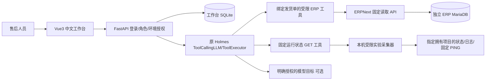

# 架构与只读边界

没有 Key 或环境没有模型授权时，按固定顺序通过**原** Tool.invoke/ToolExecutor 收集证据并运行已核验规则，标记 `rules_degraded`。有显式 Key、目标和授权时，使用原 ToolCallingLLM.call_stream 选择尚未采集的业务工具、关联证据并提出候选；必要检查随后补齐。模型不生成事实或证据内容。

业务工具绑定 ERP origin、凭据、发货单、发生时间与故障用户，参数只能是该单已读取的子行名或空对象。资源读取只展开固定 DocType 和该单引用；最小扩展核验认证、文档/行/仓库/物料/SLE权限后调用原生库存方法。版本和权限障碍进入结果限制。禁止 `run_method`、自由 SQL/Shell/Docker/URL。

原工具结果是持久审计来源。程序生成 E 编号，结果模型检查 ID唯一、实际callID、工具名、状态、payload、query、source、时间与限制均对应原调用；候选引用的编号必须存在，模型候选只能引用成功证据。并行轮触发停止后排空已提交的本轮工具结果，再禁止下一轮模型请求。

工作台自己的写入与 ERP写入分离：SQLite保存账号散列、会话散列、角色授权、工单、任务步骤、案例审核、人工动作及关闭记录；它没有 ERP 数据库连接或写工具。任务完成和工单状态在同一事务发布，详情由同一WAL快照读取。重启不假装恢复调查，明确标记中断。

运行采集器单独持有本机Docker CLI访问。Agent/工作台只见受控token的固定GET结果，没有daemon socket或自由命令入口。采集器绑定随机ERP项目、实验ID、拥有的容器/网络ID、标签及网络成员；投影去除环境变量、命令与健康检查原始输出，限制应用日志50行/900秒/12k字符。唯一exec是两个选定Redis容器的字面量 `redis-cli PING`。客户Docker接入尚须独立审核，不能用Docker socket只读挂载替代此边界。

HTTP工具有授权前后检查、响应大小/行数限制、无代理/无重定向和有界执行。每工具超过期限只返回超时，迟到结果不作为证据；已开始的只读网络读取按底层超时结束。总预算不能授权新的工具/模型请求；模型供应商的实际取消/流式超时语义仍须用该客户模型实测。

工单、日志和案例是数据而非指令。秘密不进入Toolset.config、schema、LLM prompt或报告；联系方式与凭据在进入持久证据、页面和外部模型前脱敏。外部模型只在环境授权时调用，报告记录目标及实际返回的用量；成本未知就写未知。仅私有部署工作台不能保证外部推理不出网。

案例库仅人审后可用，编辑撤销审核；精确版本匹配只产生参考，必要证据与判定条件尚未满足时不能宣称软件缺陷。复核按单据和实际未取消出库流水检查业务完成，再提示原候选是否仍出现；这不证明原原因正确，也不证明物理交付。人始终控制最终关闭。
