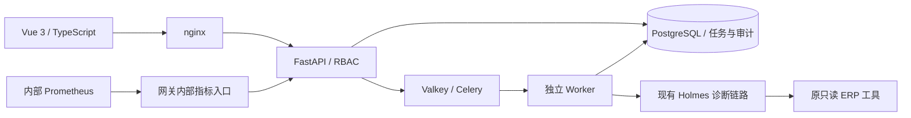

# 企业版 v2 实际验证报告

验证日期：2026-10-10，北京时间。升级基线为本地 v1 提交 `51d0fcb20f2c9fc150f8f61b7988a211de8ac02a`，目标是一个企业内部多账号协作。原上游许可证、Python 主依赖锁、旧运行目录和用户已有报告保留。

## 本次架构与修改范围

复用 Holmes 的 Tool / Toolset、ToolExecutor、ToolCallingLLM 及原 ERPNext 只读工具、业务规则和四页工作台。新增企业持久层与调度层，未重新实现 ERP 或诊断引擎。

| 层 | 实现 |
| --- | --- |
| 网页 | Vue 3、Element Plus、严格 TypeScript，账号授权与审计页面，数据库分页、请求编号 |
| API | Python 3.12.10、FastAPI，角色与环境授权、共享会话、CSRF、限流、结构化日志 |
| 数据 | SQLAlchemy 2、PostgreSQL 17.11、Alembic 1.18.4，事务、行锁、任务租约、独立迁移角色 |
| 调度 | Celery 5.6.3、Valkey 8.1.10，独立 Worker、持久待发队列、重复消息保护 |
| 部署 | nginx 1.30.5、Docker Compose，独立随机资源、非 root、内部网络、健康与就绪检查 |
| 观测 | Prometheus 3.13.4 LTS / prometheus-client 0.26.0，内部凭据采集、固定标签的请求与任务指标 |



源代码职责：`holmes/erpnext_support/{server,jobs,worker,observability}.py` 为企业服务与调度；`persistence/`、`migrations/` 与 `storage.py` 为持久层；`frontend/` 为网页；`enterprise/` 为新部署。原工具仍位于 `holmes/plugins/toolsets/erpnext_support/`。固定版本、镜像 digest 与许可见 [enterprise/VERSIONS.md](enterprise/VERSIONS.md)。

## 已执行的分层测试

下列轮次有重复用例，不能相加为独立场景数量。JUnit 的时长与控制台总时长略有差异，表中采用实际控制台总时长。

| 测试层 | 实际结果 | 耗时 | 证据 |
| --- | --- | --- | --- |
| 核心、API、任务执行 | 68 通过，ERP/模型诊断边界明确为 mock | 119.68 秒 | [JUnit](reports/enterprise-core-api-jobs-final-20261010.xml) |
| 指标、请求编号、错误边界定向复验 | 5 通过 | 52.89 秒 | [JUnit](reports/enterprise-observability-final-20261010.xml) |
| 原 Agent 循环、业务规则、运行工具契约 | 89 通过，模型及外部 HTTP 为受控 mock | 52.27 秒 | [JUnit](reports/enterprise-original-engine-contracts-20261010.xml) |
| 案例审核与分析员编辑交错定向复验 | 2 通过，两个存储连接的真实事务，HTTP 授权请求为本机测试客户端 | 51.45 秒 | [JUnit](reports/enterprise-case-review-concurrency-final-20261010.xml) |
| SQLite + 真实 PostgreSQL 存储、核心、迁移、权限组合 | 64 通过，已执行的一次性实际复制用例未重复执行 | 97.62 秒 | [JUnit](reports/enterprise-storage-final-20261010.xml) |
| 实际 SQLite → 全新 PostgreSQL 复制及应用权限 | 12 通过，合成旧库源哈希不变、会话不迁移 | 49.01 秒 | [JUnit](reports/enterprise-pg-copy-permissions-20261010.xml) |
| 最小权限、独占备份和关闭约束定向复验 | 14 通过 | 54.86 秒 | [JUnit](reports/enterprise-storage-security-final-20261010.xml) |
| 有界原子快照、当前工单快照及业务状态定向复验 | 10 通过 | 73.62 秒 | [JUnit](reports/enterprise-storage-snapshot-final-20261010.xml) |
| SQLite / 真实 PostgreSQL 关闭并重新打开后的待发任务 | 2 通过 | 53.67 秒 | [JUnit](reports/enterprise-outbox-reopen-20261010.xml) |
| 资源/中文详情审计检索、脱敏、SQL 指标分组 | 同一组 7 场景分别在 SQLite、真实 PostgreSQL 各 7/7 通过 | 42.91 / 45.49 秒 | [SQLite](reports/enterprise-audit-metrics-sqlite-20261010.xml) / [PostgreSQL](reports/enterprise-audit-metrics-pg-20261010.xml) |
| 前端 API 与组件，全量最终轮次 | 6 文件、49 mock 测试通过 | 86.84 秒 | [安全摘要](frontend/reports/enterprise-final-components-20261010.json) |
| 部署与资源作用域、健康探测策略 | 39 单元测试通过，Docker 调用边界明确为 mock | 10.07 秒 | [JUnit](enterprise/reports/deployment-unit-20261010.xml) |
| 迁移探测与内部指标采集策略补充复验 | 41 单元测试通过，含原部署用例 | 9.872 秒（JUnit） | [JUnit](enterprise/reports/deployment-policy-final-20261010.xml) |
| 最终构建源边界与有数据更新策略 | 52 单元测试通过，全部 Docker/网络调用为 mock | 12.61 秒 | [JUnit](enterprise/reports/deployment-upgrade-policy-verified-20261010.xml) |

真实存储测试使用独立项目 `holmes-enterprise-b926a562bad5`，其中 `enterprise_store_test` 与 `enterprise_migration_test` 是各自专用测试库。没有连接 ERP 数据库或生产。实际复制测试使用合成旧 SQLite；没有自动迁移用户当前 v1 工作台。

并发合同覆盖 36 次更新无丢失、同工单八次并发提交仅生成一个任务、最后有效管理员保护、作用域先过滤再分页、租约所有者及过期发布拦截、人工记录/复核/关闭事务。应用数据库角色不能执行 DDL，也不能更新或删除既有审计事件。

独立 `.venv` 编译检查和依赖一致性检查通过。实际 Docker 构建同样完成 pip check、vue-tsc 严格类型检查及生产 bundle；Element Plus 仍有超过 500KB 的 bundle 提示，未声称已完成加载性能优化。

本机已有 `.venv` 的 SQLAlchemy / Pydantic 为 2.0.54 / 2.13.5；保留的主锁与 Docker 构建分别为 2.0.51 / 2.13.4，FastAPI 均为 0.136.3、pg8000 均为 1.31.5。本机定向测试与 Docker 实栈结果采用各自实际环境，企业新增依赖另行固定，主锁没有重写。

## 整栈、网页与故障演练

首次整栈项目为 `holmes-enterprise-3245c40bfcca`，镜像 `holmes-erp-enterprise:20261010-8570ef014271`。API、数据库、队列、网关及监控健康，但 Worker 的探测重复导入全部 Holmes 依赖，超过 10 秒导致 Compose 等待失败；虽然 `/ready` 的真实数据库、队列和心跳均已为 true，该整栈轮次仍按失败保留。随后将 Worker 探测改为标准库 HTTP 检查内部 `/ready`，使用另一全新运行目录验证。该方案面向本次单 Worker，不宣称逐个证明多 Worker 活性。

队列与页面使用 `.invalid` 不可用数据源；Worker 中断演练使用容器内只提供 GET 的慢响应 Mock。它们验证企业基础设施、规则降级、缺失信息与留痕，不能作为 ERP 根因准确率或真实模型效果。

企业整栈项目 `holmes-enterprise-c63b69b8be5f` 首次使用镜像 `holmes-erp-enterprise:20261010-340f1daebb83`，启动实际 259.807 秒；迁移 exit 0，六个常驻服务随后全部 healthy。[初次启动记录](enterprise/reports/startup-final-20261010.json) 与 [初次构建输入及镜像清单](enterprise/reports/source-manifest-final-20261010.json) 保留实际观察。后续审计与指标修复采用另一个唯一镜像更新同一项目，前述时长不作为更新启动耗时。

修复后当前镜像为 `holmes-erp-enterprise:20261010-39edc000881c`，OCI manifest `sha256:6863aa62c947b0bba735fb5c87acad3116a151041154f51c3a928d087908eb8a`。受控更新为 **12/12 通过，244.817 秒**：先关闭 API 新任务准入、两次核验活跃任务为零、备份，再更新已确认的应用/迁移容器；原数据库、队列、网关、监控容器 ID、卷名、账号、会话及原配置均保持。[更新记录](enterprise/reports/upgrade-final-20261010.json) 与 [最终 312 项构建输入](enterprise/reports/source-manifest-upgrade-20261010.json) 可核对。该控制器不声称自动回滚。

修复后的整栈只读验证 **19/19 通过，18.066 秒**。实际 Prometheus target `up=1`、六种固定任务 Gauge、非 root、数据库最小权限、源文件哈希与网页资源均已核验；内部无凭据 GET 返回 403、非 GET 被拒绝，公开 `/metrics` 返回 404。迁移任务真实 exit 0，按一次性任务禁用存活探测。[实际整栈验证](enterprise/reports/deployment-upgrade-final-20261010.json)

真实 Edge 浏览器最终 **23/23 通过，31.528 秒，0 页面错误**。覆盖账号创建/授权/密码重置/停用、角色访问拒绝、审计资源检索/脱敏/分页、原四页导航及新 QA 工单诊断、人工记录、复核与显式人工例外关闭。新 QA 账号实际停用且授权清空；三张页面截图逐张检查无密码、token 或 cookie。[浏览器实际结果](frontend/reports/enterprise-ui-final-20261010.json) 与 [前端验证说明](frontend/ENTERPRISE_TEST_RESULTS.md) 保留完整阶段信息。

该浏览器工单的诊断实际 **1.215 秒、4 次调用、0/4 成功、4 条失败采证记录**，仍为 `partial / rules_degraded`，复核 `business_complete=false`。人工例外关闭只改变该 QA 工单的工作台记录，未证明 ERP 完成。此耗时属于浏览器创建的另一个工单，与前述 API 集成诊断耗时分别记录。

真实 Valkey broker 断连演练 **12/12 通过，28.506 秒**。停止所属队列后 `/ready` 为 503、API `/health` 仍 200；新任务返回 202 且持久保留 `queued / queue_publish_failed`。测试控制器恢复同一队列后 **13.206 秒**，原任务自动发布并由 Worker 消费，任务 ID 保持且无重复任务，服务重新就绪。任务实际诊断 **2.350 秒、4 次调用、0% 成功**，不可用源的失败采证保持。[实际队列故障记录](reports/enterprise-broker-outage-verified-20261010.json)

真实 Worker 中断演练最终 **12/12 通过，62.177 秒**：先在所属 Worker 内确认固定 GET-only Mock 就绪，真实持久化 1 条已完成 Mock 采证，再中断慢请求中的 Worker。旧租约到期后任务为 `interrupted`、工单为 `needs_information`，1 条调用保留；从中断到任务释放且执行进程恢复就绪 **59.771 秒**。Docker 的 `RestartCount=0`，实际由测试控制器显式重启同一所属 Worker，未将其称为自动重启。已完成的 Mock 调用成功 1/1；这不是完整诊断或真实 ERP 工具成功率，后续中断请求没有完成。[最终实际中断记录](reports/enterprise-worker-interruption-verified-20261010.json)

中断演练此前一轮 **11/11 通过，66.466 秒**，保存的 1 条初次采证为 `source_unavailable`，成功率 0/1。随后为稳定复现增加固定 Mock 就绪检查，重新执行得到上述最终结果。原 [11 项实际记录](reports/enterprise-worker-interruption-final-20261010.json) 保留，两轮不累计为独立场景数。

演练结束后的最终只读状态核验：六个常驻服务全部 healthy，迁移 exit 0，`/health` 与 `/ready` 均 200；实际任务 Gauge 为 queued=0、running=0、partial=6、interrupted=2，Prometheus 1/1 target 为 up。以上任务来自本次明确的 QA fixture。[最终状态](reports/enterprise-final-state-20261010.json)

交付文件扫描实际覆盖 **132 个变更/新增非忽略文件、86 个可获取的所属私有运行凭据值，0 命中**。3 张截图逐张复核无凭据。原 `LICENSE`、`pyproject.toml`、`poetry.lock` 没有改变，用户原 manual 报告 SHA256 保持，私有运行文件/备份不导出。[保留与凭据扫描](reports/enterprise-preservation-final-20261010.json)

真实 Docker/API/PostgreSQL/Celery 集成为 **25/25 检查点通过，86.219 秒**。覆盖真实登录、停用会话撤销、审计、同任务重复消息、任务消费、复核、证据不足拒绝普通关闭及显式人工例外关闭。[实际结果及完整脱敏诊断](reports/enterprise-live-final-20261010.json) 保留事实、候选、证据、缺失信息、建议和调用。

不可用 fixture 的诊断本身为 `partial / rules_degraded`，耗时 **2.797 秒**，实际 **4 次工具调用、成功率 0/4 = 0%**。已确认业务事实为空，仅候选“ERP API 读取不可用”；明确缺少版本核验、发货单和操作权限证据，无法确认数据库、缓存或容器根因。集成检查点通过率与工具调用成功率分别记录，未将故意失败的采证算成成功。

真实 `pg_dump` 备份 → 全新空 PostgreSQL 恢复为 **9/9 通过，79.900 秒**。备份时的 8 条业务记录、29 条审计及 3 个账号/密码哈希一致；源端 2 个会话保持，恢复端旧会话归零。另核对 1547 个已有 v1 运行文件及源端私有文件均未改变。该快照不包括后来新增的 QA 工单；包含敏感工作台业务证据，实际 dump 留在被 Git 忽略的私有目录。[恢复验证记录](enterprise/reports/backup-restore-final-20261010.json)

## 实际失败与修正

首次 API/jobs 回归 42 通过、5 失败：旧测试在修改角色后仍复用旧会话，而 v2 会立即撤销此会话，因此得到 401。测试随后先按新角色重新登录，再独立验证操作权限的 403；原失败 [JUnit](reports/enterprise-api-jobs-first-20261010.xml) 保留。没有将失败轮次改写为通过。

首次存储轮次 40 通过、12 个 PostgreSQL 参数用例因尚未提供独立连接文件跳过；后续真实 PostgreSQL 单独执行通过，原 [JUnit](reports/enterprise-storage-first-20261010.xml) 保留。部署初轮队列健康检查实际失败，原因及修正见 [enterprise/VALIDATION.md](enterprise/VALIDATION.md)。

末轮并发审查发现分析员编辑案例的初读检查与锁内更新之间可能插入审核提交，已把权限条件放入锁内再次校验。新增交错测试首次挂到测试准备连接，未触发 API 的读取，实际 1 通过、1 失败；修正为 API 连接与另一提交连接交错后 2 通过。首次 [JUnit](reports/enterprise-case-review-concurrency-20261010.xml) 保留。

真实浏览器首轮在 12 个检查点通过后，审计按资源编号查询失败，耗时 17.998 秒。后端原查询只检索请求编号、操作者和操作名，与页面展示的资源/详情检索契约不一致；失败账号随后实际停用并清空授权。[失败记录](frontend/reports/enterprise-ui-initial-failure-20261010.json) 保留。

修复后第二轮浏览器 16 个检查点通过，再因测试脚本的未限定导航定位同时匹配“工单工作台”和“返回工单工作台”而失败，耗时 21.088 秒；只将定位限定在导航容器，新一轮 23 个检查点通过。[导航定位原失败](frontend/reports/enterprise-ui-navigation-first-failure-20261010.json) 保留。

首次内部指标采集遇到两层真实错误：`api` 内部主机名被 Host 校验拒绝（400）；改为未发布的网关内部入口并固定 Host 后，PostgreSQL 聚合又暴露位置参数重复导致分组失败（503）。修复使用 SELECT 别名分组，避免依赖 SQLite 对参数表达式的容忍。最终结果以修复后实际 PostgreSQL 与 Prometheus 采集为准。
原始 [失败采集记录](enterprise/reports/metrics-first-failure-20261010.json) 保留。

指标修复后的整栈验证控制器首轮把 POST 拒绝状态过严写为必须 405；实际 nginx 安全返回 403、HEAD 返回 405。随后校验明确拒绝的 403/405，服务端访问策略保持，完整 19 个检查点通过。[控制器原失败](enterprise/reports/deployment-verification-relay-assertion-first-20261010.json) 保留。

最终部署策略首次执行时 52 个断言通过，但误继承了上游全仓覆盖率门槛，命令整体 exit 1；[原始 JUnit](enterprise/reports/deployment-upgrade-build-policy-final-20261010.xml) 的 0 失败不代表该命令成功。随后隔离配置与根 conftest 后整组 52 项通过、命令 exit 0。没有声称本次完成上游全仓测试或覆盖率评估。

队列断连演练首轮在 `postgres_retained_queued_task` 断言处失败，15.447 秒；脚本误将内部日志标识 `broker_unavailable` 作为存储接口应返回的标识，实际存储统一为 `queue_publish_failed`。队列在 `finally` 中已恢复，随后 `/ready` 200；仅修测试契约后新一轮 12/12 通过。[原失败记录](reports/enterprise-broker-outage-final-20261010.json) 保留，文件名中的 final 不改变其 `status=failed` 的事实。

演练后的最终状态辅助校验首轮尝试在最小 Prometheus 镜像执行 Python，Docker exec 返回 127；改为从已有 API 容器只读访问内部监控接口后完成。服务配置保持，原 [控制器失败](reports/enterprise-final-state-controller-first-failure-20261010.json) 保留。

## 复现与边界

中文启动、停止、备份恢复命令见 [enterprise/README.md](enterprise/README.md)；显式只读迁移见 [持久层说明](../../holmes/erpnext_support/persistence/README.md)；升级范围见 [ENTERPRISE_UPGRADE.md](ENTERPRISE_UPGRADE.md)。新增 [GitHub Actions](../../.github/workflows/erp-support-enterprise.yml) 已在本机检查 YAML 和测试选择，未推送、未在 GitHub 执行。

故障脚本仅适用于通过 `--unavailable-fixture` 新建的隔离企业项目。执行前结束其他浏览器或 API 诊断测试，保留当前配置路径，输出文件必须不存在。它们验证并只操作所属项目的容器；队列脚本在 `finally` 恢复测试队列，Worker 脚本只恢复被测试控制器中断的 Worker。该操作属于隔离演练控制器，诊断 Agent 本身没有 Docker socket，也没有自动修复能力。

```powershell
Set-Location E:\ai\holmesgpt
$env:PYTHONPATH = (Get-Location).Path
# $taskConfig 是本次 Prepare/Upgrade 返回的配置文件完整路径。
.\.venv\Scripts\python.exe tests\erpnext_support\enterprise_broker_outage.py `
  --config $taskConfig --output examples\erpnext-support\reports\broker-outage-new.json
if ($LASTEXITCODE -ne 0) { throw '队列故障验收失败，请查看脱敏报告。' }
.\.venv\Scripts\python.exe tests\erpnext_support\enterprise_worker_restart.py `
  --config $taskConfig --output examples\erpnext-support\reports\worker-interruption-new.json
if ($LASTEXITCODE -ne 0) { throw 'Worker 中断验收失败，请查看脱敏报告。' }
```

本次没有真实模型调用、费用或根因命中率数据，没有重新执行 v1 的真实 ERP 场景。v1 报告 [TEST_REPORT.md](TEST_REPORT.md) 是历史记录。当前尚未实现 OIDC/MFA、多企业租户、跨机 HA 或生产规模压测；企业入口仅本机，外部客户接入、TLS、业务权限与运维流程需按实际试点环境验收。诊断始终只读，不执行 ERP 自动修复。

企业版使用独立 PostgreSQL 库。用户已有 SQLite 与私有配置保留，没有自动导入；可按持久层文档在另一个空目标中明确执行只读复制，再核验并切换。当前登录文件位于 `enterprise/.runtime/holmes-enterprise-c63b69b8be5f/state/initial-login.json`，当前管理配置为同目录的 `config-version-7fd288c93ab6.json`。
